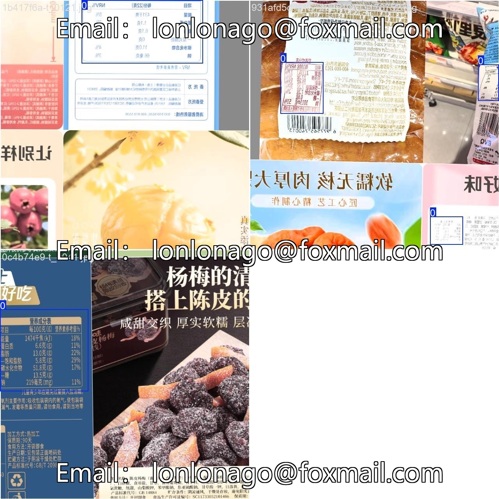
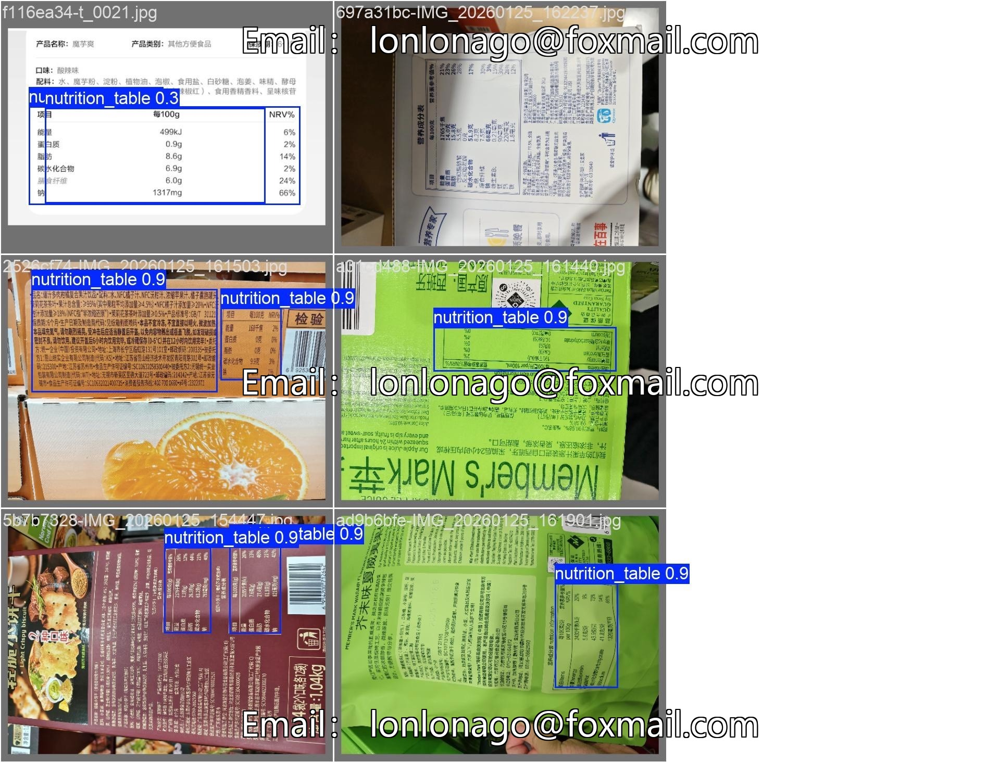

# Based on the YOLOv11 food nutrition ingredient list target detection project, automated recognition of food

## Body

Based on the YOLOv11 food nutrition ingredient list target detection project, it automatically recognizes the nutritional content and ingredient lists in food packaging. It is suitable for scenarios such as automated entry of food information, packaging quality inspection, and e-commerce product information analysis.

The project provides full-process code for environment configuration, model training, and inference prediction, ready to use out of the box without the need for complex debugging. The code includes environment installation, dataset, training scripts, inference scripts, etc., and can be directly run.

Virtual materials, once sold, are non-refundable.
Interested friends, click "I want" to proceed.

## Images

## Payment

Here is a pay link on Stripe ( https://buy.stripe.com/3cs8yP7sY87d0vu9AB ). Please contact me lonlonago@foxmail.com after funding $89, and I will send you a complete data files , thank you!

